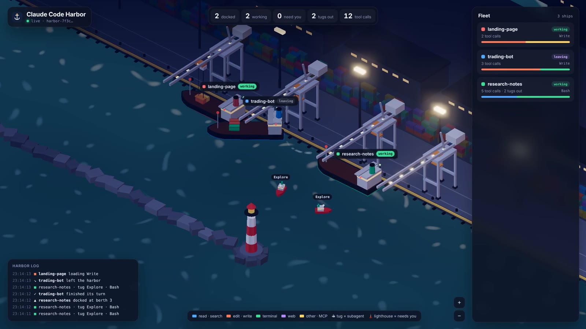
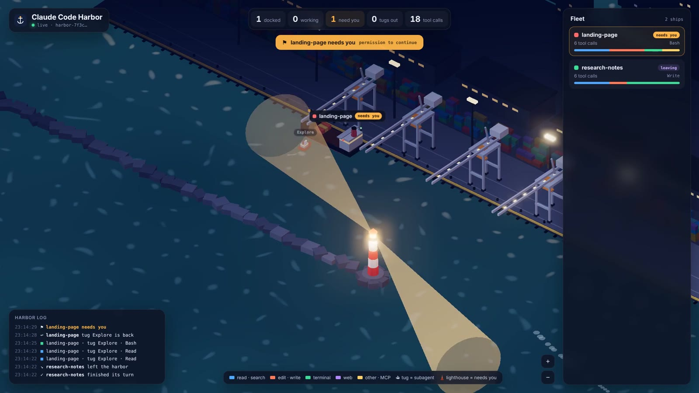

# Claude Code Harbor

A live 3D harbor for your Claude Code sessions.

**→ [Open Claude Code Harbor](https://kriptochel228.github.io/claude-code-harbor/)** · [watch a replay of a real run](https://kriptochel228.github.io/claude-code-harbor/#demo)



- Each **session** sails in and docks as a ship.
- Each **tool call** is a container the crane loads: blue for read/search, coral for edit/write, green for terminal, violet for web, yellow for everything else.
- Each **subagent** heads out as a tugboat and comes back when it's done.
- When a session **needs you** (a permission prompt, or it's waiting for input), the lighthouse turns on.



It runs on Claude Code [hooks](https://code.claude.com/docs/en/hooks), which are plain shell commands, so it uses **zero tokens**. It works in any browser, on your computer or your phone.

## Setup (1 prompt, ~1 minute)

1. Open [the page](https://kriptochel228.github.io/claude-code-harbor/). With no channel in the link, it shows a setup prompt.
2. Copy that prompt and paste it into Claude Code. It will:
   - save `hook.sh` to `~/.claude/harbor/`
   - create a random private channel name in `~/.claude/harbor/topic`
   - add the hooks to `~/.claude/settings.json`, keeping everything already there
   - send one test message and reply with your personal link
3. Open your link and restart your Claude Code sessions. They'll sail in.

## What gets sent

The hook sends one short line per event to your own channel on [ntfy.sh](https://ntfy.sh) (a free real-time message relay):

```json
{"e":"PreToolUse","s":"1d218b4c","p":"my-app","t":"Bash","ts":1793563615}
```

That's the event name, the first 8 characters of the session id, the project **folder name**, and the tool name. Prompts, code, commands, file paths and file contents are **never** sent. Set `HARBOR_HIDE_PROJECT=1` to hide folder names too.

The channel name is random and acts as the password: anyone who has your link can watch your harbor, so keep it private.

## Limits

- Events are batched (at most one message every 10 seconds, plus one right away for important events) to stay within ntfy.sh's public rate limits. Very heavy use can still hit them. If that happens, [self-host ntfy](https://docs.ntfy.sh/install/) and set `HARBOR_URL` to your server.
- Tested end-to-end on Linux. The script uses only bash, grep, sed, date and curl, so it should run unchanged on macOS. On Windows it needs `bash` from Git Bash on your PATH.
- A ship with no events for 30 minutes leaves on its own.

## Uninstall

Remove the Harbor entries from the `hooks` section of `~/.claude/settings.json` and delete `~/.claude/harbor/`.

## Host your own copy

The page is a single file: `index.html`. Put it on GitHub Pages, Vercel or any static host. The setup prompt fills in whatever URL the page is served from.

MIT License.
